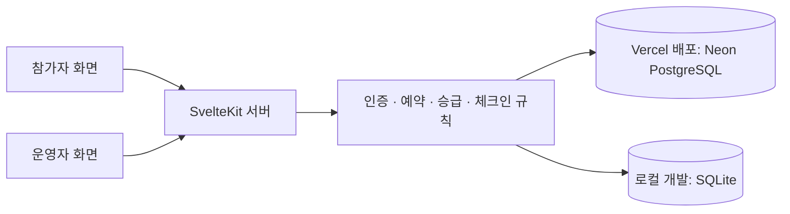

# CONVENE

**참가 등록부터 세션 예약, 개인 일정, QR 패스, 운영자 체크인까지 연결한 컨퍼런스 플랫폼입니다.**

RainFocus의 이벤트 운영 사례에서 영감을 받아 만든 Svelte 기반 풀스택 포트폴리오입니다. 참가자 화면과 운영자 화면이 같은 데이터베이스를 사용하며, 예약·취소·대기자 승급 결과가 개인 일정과 운영자 현황에 함께 반영됩니다.

웹사이트 UI는 영어이며, 행사·연사·콘텐츠는 가상으로 제작했습니다. RainFocus나 Zscaler와 공식적인 관계는 없습니다.

| 바로가기        | 주소                                                                                   |
| --------------- | -------------------------------------------------------------------------------------- |
| 배포된 웹사이트 | **[CONVENE 열기](https://convene-coral-six.vercel.app)**                               |
| 데모 로그인     | [Sign in](https://convene-coral-six.vercel.app/login)                                  |
| 참가 등록       | [Register](https://convene-coral-six.vercel.app/register)                              |
| 세션 탐색       | [Sessions](https://convene-coral-six.vercel.app/sessions)                              |
| 운영자 대시보드 | [Organizer dashboard](https://convene-coral-six.vercel.app/admin) · 운영자 로그인 필요 |
| GitHub          | [dongyunkim96/Convene](https://github.com/dongyunkim96/Convene)                        |

## 목차

- [프로젝트 소개](#프로젝트-소개)
- [주요 기능](#주요-기능)
- [데모 계정과 초대 코드](#데모-계정과-초대-코드)
- [웹사이트 사용법](#웹사이트-사용법)
- [기술 구성과 구조](#기술-구성과-구조)
- [로컬 실행](#로컬-실행)
- [GitHub와 Vercel 배포](#github와-vercel-배포)
- [테스트와 검증 결과](#테스트와-검증-결과)
- [개발에 사용한 스킬과 도구](#개발에-사용한-스킬과-도구)
- [현재 지원 범위](#현재-지원-범위)
- [관련 문서](#관련-문서)

## 프로젝트 소개

가상의 2일 기술 컨퍼런스를 운영하는 서비스입니다. 참가 등록과 세션 좌석 예약을 구분하고, 운영자가 같은 기록으로 참가 현황과 체크인을 관리하도록 구성했습니다.

| 항목              | 내용                                               |
| ----------------- | -------------------------------------------------- |
| 행사              | CONVENE · 2027년 5월 20–21일                       |
| 프로그램          | 세션 24개, 연사 12명, 트랙 4개, 행사장 내 공간 4개 |
| 행사 시간대       | `America/New_York` · 행사 기간 EDT, UTC−4          |
| 사용자 유형       | 일반 참가자, VIP 참가자, 연사, 운영자              |
| 호스팅            | Vercel                                             |
| 배포 데이터베이스 | Neon PostgreSQL                                    |
| 로컬 데이터베이스 | Node 내장 SQLite                                   |

## 주요 기능

| 영역            | 구현 내용                                                                       |
| --------------- | ------------------------------------------------------------------------------- |
| 참가 등록       | 유형 선택 → 기본 정보 → 선호 항목 → 검토의 4단계 등록, 입력 검증, 동의 확인     |
| 로그인·프로필   | 쿠키 기반 세션 인증, 프로필 조회·수정, 로그아웃                                 |
| 프로그램 탐색   | 세션 상세, 연사 소개, 검색, 날짜·트랙·연사·좌석 상태·레벨 필터                  |
| 탐색 상태 유지  | URL 쿼리 기반 필터와 상세 화면에서 돌아왔을 때 검색 상태 유지                   |
| 좌석 예약       | 정원 확인, 중복 예약 방지, 시간 충돌 검사, 취소 확인                            |
| 대기자 관리     | 만석 세션 대기 등록, 취소·정원 증가 시 적격 대기자 순차 승급, 앱 내 알림        |
| 개인 일정       | 날짜별 예약 일정, 인쇄, `.ics` 캘린더 다운로드                                  |
| 참가 패스       | 실제 QR 이미지 생성, PNG 다운로드, 인쇄, 수동 확인용 토큰                       |
| 운영자 대시보드 | 참가자 검색, 예약 일정, 유형별 인원, 세션별 예약·대기·잔여 좌석, 최근 변경 이력 |
| 운영 관리       | 세션 정원 변경, 패스 확인과 행사 체크인, 중복 체크인 방지, CSV 내보내기         |
| 반응형·접근성   | 모바일 탐색 메뉴, 필터 모달, 키보드 이동, 포커스 복원, 동작 축소 설정 대응      |

### 예약과 대기자 처리 규칙

- 시간대가 겹치는 세션을 동시에 확정 예약할 수 없습니다. 앞 세션 종료와 다음 세션 시작이 같은 경우는 허용합니다.
- 이미 예약한 세션을 새 예약으로 자동 교체하지 않습니다. 충돌 내용을 확인하고 직접 취소할 수 있습니다.
- 대기 등록은 확정 좌석을 차지하지 않습니다.
- 취소 또는 정원 증가 시, 먼저 등록한 대기자부터 자격과 시간 충돌을 확인해 승급합니다. 충돌 때문에 건너뛴 참가자는 대기열에 남습니다.
- 정원을 현재 확정 예약자 수보다 작게 줄일 수 없습니다.
- VIP 세션은 서버에서 VIP 자격을 검사합니다. 연사 유형은 VIP나 운영자 권한을 부여하지 않습니다.
- 예약·취소·승급은 트랜잭션으로 처리하고, 데이터베이스 제약과 트리거로 정원 초과 등을 추가로 방지합니다.

## 데모 계정과 초대 코드

**모든 데모 계정의 비밀번호는 `Convene2027!`입니다.**

[로그인 페이지](https://convene-coral-six.vercel.app/login)의 데모 계정 버튼을 누르면 로그인 정보가 채워집니다. 이후 **Sign in**을 누르세요.

| 계정             | 로그인 이메일                | 확인할 수 있는 흐름                                                                   |
| ---------------- | ---------------------------- | ------------------------------------------------------------------------------------- |
| 일반 참가자      | `alex@convene.demo`          | 개인 일정·패스·예약. 초기 데이터에 “Building software that lasts” 예약 포함           |
| VIP 참가자       | `vip@convene.demo`           | 일반 기능과 VIP 세션 예약                                                             |
| 연사             | `speaker@convene.demo`       | 연사 유형의 참가자 경험. 운영자 권한은 없음                                           |
| 운영자           | **`organizer@convene.demo`** | 전체 참가 현황, 정원 관리, CSV, 패스 확인과 체크인                                    |
| 좌석 보유 참가자 | `casey@convene.demo`         | 초기 데이터에 “Your data deserves better”의 유일한 좌석 보유. 취소·대기자 승급 시연용 |

공유 데모이므로 실제 예약 현황은 방문자의 사용에 따라 달라질 수 있습니다. 위의 예약 설명은 초기 데이터 기준입니다.

| 신규 참가 등록 유형 | 초대 코드         |
| ------------------- | ----------------- |
| 일반 참가자         | 필요 없음         |
| VIP 참가자          | `CONVENE-VIP`     |
| 연사                | `CONVENE-SPEAKER` |

운영자 권한은 신규 참가 등록에서 선택할 수 없습니다. 위 계정과 코드는 포트폴리오 시연을 위해 공개한 값입니다.

## 웹사이트 사용법

### 참가자

1. **Register**에서 새 참가자로 등록하거나 데모 계정으로 로그인합니다.
2. **Sessions**에서 세션을 검색하고 날짜·트랙 등의 필터를 적용합니다.
3. 상세 화면에서 **Reserve seat**로 좌석을 예약합니다. 만석이면 **Join waitlist**로 대기 등록합니다.
4. **My Schedule**에서 확정 예약과 대기 상태를 확인합니다. 예약 취소, 일정 인쇄, 캘린더 다운로드도 이곳에서 진행합니다.
5. **My Pass**에서 QR 패스를 확인하고 다운로드하거나 인쇄합니다. 수동 토큰을 표시해 운영자에게 전달할 수도 있습니다.
6. **Profile**에서 정보를 수정하거나 로그아웃합니다.

### 운영자

1. `organizer@convene.demo` / `Convene2027!`로 로그인합니다. 로그인 후 운영자 대시보드로 이동합니다.
2. 상단에서 등록 참가자 수, 확정 예약 수, 대기 등록 수, 행사 체크인 수를 확인합니다.
3. **Registered attendees**에서 이름·이메일·등록번호로 검색하고 참가 유형, 체크인 상태, 확정 일정을 확인합니다.
4. **Session reservations**에서 세션 제목을 눌러 예약자·대기자 명단을 보고 **Session capacity**를 수정합니다.
5. 참가자의 패스 토큰을 **Pass token**에 붙여 넣고 **Verify & check in**을 누르면 행사 체크인이 기록됩니다. 재확인하면 이미 체크인된 상태를 알려줍니다.
6. **Export CSV**로 이름·이메일·유형·등록번호·체크인 상태·예약 수·대기 수를 다운로드합니다.
7. 다른 참가자의 변경 사항은 **Refresh data**를 누르거나 화면을 다시 방문해 가져옵니다. 자동 실시간 갱신 방식은 아닙니다.

**좌석 예약 수와 행사 체크인 수는 다른 지표입니다.** 체크인은 행사 입장을 기록하며, 각 세션의 실제 출석을 의미하지 않습니다.

### 예약 충돌과 대기자 승급 시연

1. 새 일반 참가자로 등록하고 **Building software that lasts**를 예약합니다.
2. **Beyond the AI prototype**을 예약해 시간 충돌 안내와 기존 예약 링크를 확인합니다.
3. **Your data deserves better**가 만석인 상태에서 대기 등록합니다.
4. 별도 브라우저 프로필이나 시크릿 창에서 Casey 계정으로 로그인해 해당 예약을 취소합니다.
5. 원래 참가자의 **My Schedule**을 새로고침해 예약 승급과 알림을 확인합니다.
6. 해당 참가자의 패스 토큰을 운영자 화면에서 확인하고 체크인합니다.

한 브라우저 프로필의 탭들은 로그인 쿠키를 공유합니다. 여러 계정을 동시에 시연하려면 독립된 브라우저 프로필이나 일반 창과 시크릿 창을 사용하세요. 공유 데모에서 만석 상태나 대기 순서가 바뀌었다면 새 로컬 DB에서 초기 데이터로 시연할 수 있습니다.

## 기술 구성과 구조

| 구분               | 기술                                                 |
| ------------------ | ---------------------------------------------------- |
| UI·서버 프레임워크 | Svelte 5, SvelteKit 3                                |
| 언어·빌드          | TypeScript 6, Vite 8, Node.js 24.x                   |
| 스타일·아이콘      | Tailwind CSS 4, `@lucide/svelte`                     |
| 입력 검증·QR       | Zod, `qrcode`                                        |
| 배포 DB            | Neon PostgreSQL, `pg` 연결 풀                        |
| 로컬 DB            | Node 내장 `node:sqlite`                              |
| 배포 어댑터        | Vercel: `adapter-vercel` / 로컬 서버: `adapter-node` |
| 테스트             | Vitest, PGlite, Playwright, axe-core, jsQR           |

정확한 의존성 버전은 [package.json](package.json)과 [package-lock.json](package-lock.json)에 기록되어 있습니다.



| 경로                       | 역할                                          |
| -------------------------- | --------------------------------------------- |
| `src/routes/`              | 페이지, 서버 데이터 로드, 폼 액션, API        |
| `src/lib/components/`      | 공통 UI 컴포넌트                              |
| `src/lib/server/domain.ts` | 예약·취소·승급·정원·체크인 규칙               |
| `src/lib/server/db.ts`     | PostgreSQL/SQLite 연결과 비동기 쿼리·트랜잭션 |
| `src/lib/server/auth.ts`   | 비밀번호 검증과 인증 세션                     |
| `migrations/`              | 테이블·인덱스·제약·트리거                     |
| `scripts/`                 | DB 초기화, 배포 빌드, 테스트 서버             |
| `tests/`                   | 도메인·DB 테스트와 브라우저 E2E 테스트        |
| `docs/`                    | 리서치, 검증 기록, 배포·DB 상세 문서          |

PostgreSQL 트랜잭션은 전용 연결을 사용하고 AsyncLocalStorage로 쿼리 범위를 유지합니다. 쓰기 작업에는 프로세스 간 advisory lock을 적용합니다. 로컬 SQLite는 쓰기 트랜잭션과 비동기 접근을 직렬화합니다.

비밀번호는 salt를 포함한 `scrypt`로 처리합니다. 인증 토큰은 무작위로 발급해 DB에 해시로 저장하며, 7일 만료와 HttpOnly/SameSite 쿠키를 사용합니다. HTTPS에서는 Secure 쿠키를 적용합니다. 운영자 권한과 변경 요청의 Origin은 서버에서 검사합니다.

시간은 UTC ISO 문자열로 저장하고 행사 시간대로 표시합니다. `.ics`는 UTC 시각과 고정 식별자를 사용합니다. 홈페이지의 다음 일정은 데모 프로그램 순서 기준이며, 체크인·변경 이력의 시각은 실제 처리 시각입니다.

## 로컬 실행

**Node.js 24.x가 필요합니다.** 실행 전 `node --version`으로 버전을 확인하세요.

```sh
git clone https://github.com/dongyunkim96/Convene.git
cd Convene
npm ci --include=dev --legacy-peer-deps
npm run db:migrate
npm run db:seed
npm run dev
```

접속 주소: **[http://127.0.0.1:5173](http://127.0.0.1:5173)**

`--legacy-peer-deps`는 개발 당시 npm의 optional peer 의존성 해석 문제를 우회하기 위해 사용했습니다. Windows에서 여러 Node 버전을 사용한다면 Node와 npm이 Node 24 환경에서 실행되는지 확인하세요.

### 로컬 데이터와 환경변수

DB 연결 정보를 별도로 설정하지 않으면 `data/convene.sqlite`를 사용합니다. 로컬 기본 실행에는 외부 DB나 비밀키가 필요하지 않습니다.

| 변수            | 용도                                                    | 설정 위치                                                          |
| --------------- | ------------------------------------------------------- | ------------------------------------------------------------------ |
| `DATABASE_PATH` | SQLite 파일 경로. 기본값 `./data/convene.sqlite`        | 로컬에서 선택적으로 설정                                           |
| `DATABASE_URL`  | Neon/PostgreSQL 연결 문자열                             | Vercel 배포 환경에 필수. 로컬 PostgreSQL 사용 시에만 로컬에도 설정 |
| `APP_ORIGIN`    | 독립 Node 서버의 Origin. 기본값 `http://127.0.0.1:3000` | 해당 서버의 다른 주소 사용 시 빌드 전에 설정                       |

DB CLI는 셸 환경변수를 읽습니다. `.env` 파일을 명시적으로 읽어 실행하려면 Node 24에서 다음과 같이 사용할 수 있습니다.

```sh
node --env-file=.env --import tsx scripts/database.ts seed
```

마이그레이션과 시드는 반복 실행해도 기존 등록·예약을 삭제하지 않습니다. 시드 재실행은 기존 행사의 세션 설명 등을 갱신하며, 활동 기록 초기화 명령이 아닙니다. 새 데모 데이터가 필요하면 새로운 `DATABASE_PATH`를 사용하세요. 로컬 SQLite 기록이 Neon으로 자동 업로드되지는 않습니다.

### 로컬 프로덕션 빌드

```sh
npm run build
npm start
```

기본 접속 주소는 `http://127.0.0.1:3000`입니다. 다른 주소로 독립 서버를 운영할 때는 `APP_ORIGIN`을 해당 주소로 설정한 뒤 빌드합니다.

## GitHub와 Vercel 배포

현재 배포는 GitHub의 `main` 브랜치와 Vercel을 연결한 구조입니다. 변경 사항을 `main`에 푸시하면 연결된 Vercel 프로젝트에서 배포를 진행합니다.

```sh
git add README.md
git commit -m "Update project documentation"
git push origin main
```

### Vercel 설정

| 항목              | 값                                           |
| ----------------- | -------------------------------------------- |
| Repository        | `dongyunkim96/Convene`                       |
| Production Branch | `main`                                       |
| Root Directory    | 저장소 루트                                  |
| Framework Preset  | SvelteKit                                    |
| Node.js           | 24.x                                         |
| Install Command   | `npm ci --include=dev --legacy-peer-deps`    |
| Build Command     | `npm run deploy:vercel`                      |
| Output Directory  | 수동 override 없이 프레임워크 기본 설정 사용 |

[vercel.json](vercel.json)에 프레임워크와 설치·빌드 명령을 기록했습니다. Vercel에서는 전용 어댑터가 `.vercel/output`에 정적 파일과 서버 함수를 생성합니다.

### Neon DB 연결과 비밀키

1. Vercel 프로젝트에서 Neon 통합을 연결합니다.
2. **Production / Preview** 환경에 `DATABASE_URL`이 연결되어 있는지 확인합니다.
3. 변경 사항을 푸시하거나 Vercel에서 재배포합니다.
4. 배포 빌드가 DB 마이그레이션·시드 입력을 수행한 다음 앱을 빌드합니다.

**현재 배포는 이미 연결된 Vercel의 `DATABASE_URL`을 사용합니다. 추가 비밀키 입력이나 로컬 `.env.local` 파일은 필요하지 않습니다.** 연결 문자열을 README나 Git에 넣지 마세요. `.env` 계열 파일과 로컬 DB는 Git에서 제외됩니다.

배포 초기화는 기존 참가자·예약·대기·체크인 기록을 보존합니다. Vercel에서는 SQLite로 자동 대체하지 않으며, DB 연결 또는 초기화가 실패하면 빌드가 실패하도록 구성했습니다. Preview를 같은 DB에 연결하면 데이터도 공유하므로, 분리가 필요한 경우 Neon 브랜치와 환경별 연결을 별도로 설정합니다.

### 배포 문제 해결 기록

| 증상                                          | 원인과 적용한 해결                                                                            |
| --------------------------------------------- | --------------------------------------------------------------------------------------------- |
| `STATIC_BUILD_NO_OUT_DIR`: `public` 폴더 없음 | SvelteKit 서버 앱을 정적 출력으로 취급한 설정 문제. Vercel 어댑터와 프레임워크·빌드 설정 적용 |
| Node 버전이 새 메이저로 자동 변경된다는 경고  | `engines.node`를 `24.x`로 지정                                                                |
| 배포 DB 초기화 필요                           | Vercel 환경변수로 마이그레이션·시드를 실행하는 배포 명령 추가                                 |
| 정원 입력을 빠르게 수정하면 이전 값으로 변경  | 화면 hydration 준비 전 입력을 막고, 테스트에서 실제 저장된 정원을 다시 확인                   |

Vercel에는 로컬 주소를 `APP_ORIGIN`으로 넣을 필요가 없습니다. 배포 환경은 실제 요청 Origin을 사용합니다. 자세한 설정은 [Vercel 문서](docs/VERCEL.md)와 [PostgreSQL 문서](docs/POSTGRES.md)를 참고하세요.

## 테스트와 검증 결과

2026년 10월 29일 실행한 검증 결과입니다. 자세한 증거와 범위는 [검증 기록](docs/VERIFICATION.md)에 정리했습니다.

| 검증                                                | 결과                                                        |
| --------------------------------------------------- | ----------------------------------------------------------- |
| Svelte·TypeScript 진단                              | 오류 0개, 경고 0개                                          |
| 도메인·SQLite 테스트                                | 17개 통과                                                   |
| PGlite의 실제 PostgreSQL 마이그레이션·트리거 테스트 | 7개 통과                                                    |
| 로컬 프로덕션 브라우저 E2E                          | 5개 통과                                                    |
| 실제 Vercel + Neon 브라우저 E2E                     | **5개 통과 · 36.7초**                                       |
| 정원 1명에 대한 두 계정의 동시 예약                 | 확정 1명, 대기 1명 확인                                     |
| 배포 빌드                                           | Vercel Linux 빌드·DB 초기화 성공, READY 확인                |
| 포맷·반응형·접근성                                  | 포맷 검사, 주요 화면 axe 검사, 키보드·다양한 화면 너비 확인 |

브라우저 테스트는 신규 등록, 초대 코드와 동의 검증, 검색 상태 유지, 예약·충돌·취소·승급, 새로고침 후 저장 상태, 권한 거부, 실제 QR 이미지 해독, 운영자 체크인과 중복 처리, 프로필 저장, 모바일 사용 흐름을 포함합니다.

```sh
npm run check
npm run format:check
npm test
npx playwright install chromium
npm run test:e2e
```

로컬 E2E는 자체 프로덕션 서버와 별도 임시 SQLite DB를 생성하며 개발 DB를 수정하지 않습니다. `TEST_BASE_URL`로 기존 서버를 지정하면 자동 서버 설정을 생략하고 그 서버의 데이터를 변경합니다. 배포 검증은 가상 데이터만 있는 이 데모 환경에서 수행했으며, 실제 참가자 데이터가 있는 서비스에는 그대로 실행하지 마세요.

스크린샷은 `artifacts/`, 실패 추적은 `test-results/`, HTML 보고서는 `playwright-report/`에 생성되며 Git에서 제외됩니다. 자동 접근성 검사는 WCAG 인증이나 실제 보조기기 검증을 대체하지 않습니다. 별도 lint 스크립트는 구성하지 않았습니다.

개발 시점에는 빌드 도구의 `deepmerge` 의존성에서 낮은 심각도의 [보안 권고 GHSA-gcqx-w48m-w2h4](https://github.com/advisories/GHSA-gcqx-w48m-w2h4)가 확인됐습니다. 당시 호환 가능한 패치는 제공되지 않았으며, 이 기록은 모든 의존성에 보안 문제가 없다는 의미가 아닙니다.

## 개발에 사용한 스킬과 도구

아래는 개발·배포 과정에서 활용하거나 참고한 **Codex 작업 스킬**입니다. 웹사이트의 런타임 의존성이 아니므로, 앱을 실행하는 사람이 설치할 필요는 없습니다.

| 스킬                        | 적용·참고 범위                                                                             |
| --------------------------- | ------------------------------------------------------------------------------------------ |
| `sites:sites`               | 로컬 저장소 기반 웹사이트 제작 절차와 구현 방향 참고. 사이트는 Vercel에 배포               |
| `vercel:deployments-cicd`   | 배포 구성, 빌드·배포 상태와 로그 확인, GitHub 연동 흐름                                    |
| `vercel:bootstrap`          | 저장소·배포 프로젝트·DB 연결과 초기화 순서 참고. 최종적으로 Vercel 전용 환경변수 방식 적용 |
| `vercel:vercel-storage`     | Neon PostgreSQL 연결, 로컬 SQLite와 배포 DB의 역할 구분                                    |
| `vercel:marketplace`        | Vercel 통합을 통한 외부 DB 연결 절차 참고                                                  |
| `vercel:env-vars`           | 환경별 `DATABASE_URL` 관리와 연결 문자열을 로컬·Git에 남기지 않는 구성                     |
| `computer-use:computer-use` | 브라우저·UI 접근 시도. 환경 제약으로 최종 자동 브라우저 검증은 Playwright로 수행           |

함께 사용한 도구는 Git, npm, Vercel 연결 도구, 공식 문서 웹 리서치, Playwright, Vitest, axe-core, jsQR입니다. 디자인은 접근 가능한 이벤트 서비스 사례와 공식 문서를 참고해 제작했으며, 참고 자료와 열람 제한은 [리서치 기록](docs/RESEARCH.md)에 구분했습니다.

## 현재 지원 범위

- 포트폴리오용 공유 데모입니다. 공개 운영자 계정과 재사용 가능한 초대 코드를 포함합니다.
- QR 생성·해독과 수동 토큰 체크인은 구현되어 있습니다. 카메라 촬영 기반 스캐너와 세션별 실제 출석 기록은 구현하지 않았습니다.
- 결제, 이메일·푸시 발송, 자동 캘린더 동기화, 계정 복구, 이메일 인증, MFA, 요청 속도 제한은 구현하지 않았습니다. 대기자 승급은 앱 안의 알림과 일정으로 확인합니다.
- 프로필에서 이메일·참가 유형을 변경하는 기능과 운영자의 세션 신규 생성·삭제 기능은 제공하지 않습니다. 세션 운영 화면은 예약·대기 명단 확인과 정원 변경을 지원합니다.
- 실제 기기 카메라, Safari·Firefox, 현장 스캐너, 지속 부하, 개별 Vercel 인스턴스 배치에 대한 검증은 수행하지 않았습니다.

## 관련 문서

| 문서                                     | 내용                                                            |
| ---------------------------------------- | --------------------------------------------------------------- |
| [리서치와 디자인 결정](docs/RESEARCH.md) | 참고한 서비스·기술 문서, 적용한 UX, 접근할 수 없었던 자료       |
| [검증 결과](docs/VERIFICATION.md)        | 실행한 테스트, 수정한 문제, 로컬·배포 검증 범위                 |
| [Vercel 배포 설정](docs/VERCEL.md)       | 어댑터, 설치·빌드 설정, 출력 디렉터리 오류 해결                 |
| [Neon PostgreSQL 구성](docs/POSTGRES.md) | Vercel 전용 비밀키 관리, DB 초기화, 데이터 보존과 트랜잭션 정책 |
