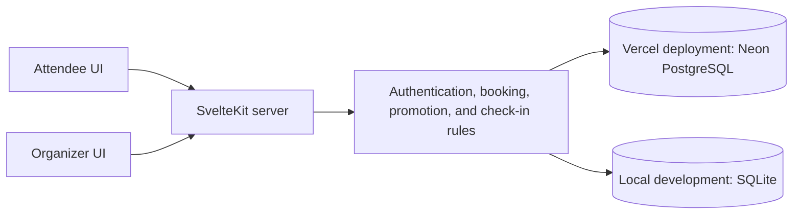

# CONVENE

**A conference platform connecting attendee registration, session reservations, personal schedules, QR passes, and organizer check-in.**

CONVENE is a full-stack Svelte portfolio project inspired by RainFocus event-management case studies. Attendee and organizer screens share the same database, so reservations, cancellations, and waitlist promotions appear in both personal schedules and organizer reports.

The interface is in English. The event, speakers, and content are fictional. This project is not affiliated with RainFocus or Zscaler.

| Quick links           | URL                                                                                          |
| --------------------- | -------------------------------------------------------------------------------------------- |
| Live website          | **[Open CONVENE](https://convene-coral-six.vercel.app)**                                     |
| Demo login            | [Sign in](https://convene-coral-six.vercel.app/login)                                        |
| Attendee registration | [Register](https://convene-coral-six.vercel.app/register)                                    |
| Browse sessions       | [Sessions](https://convene-coral-six.vercel.app/sessions)                                    |
| Organizer dashboard   | [Organizer dashboard](https://convene-coral-six.vercel.app/admin) · Organizer login required |
| GitHub                | [dongyunkim96/Convene](https://github.com/dongyunkim96/Convene)                              |

## Contents

- [Project overview](#project-overview)
- [Features](#features)
- [Demo accounts and invitation codes](#demo-accounts-and-invitation-codes)
- [User guide](#user-guide)
- [Technology and architecture](#technology-and-architecture)
- [Local development](#local-development)
- [GitHub and Vercel deployment](#github-and-vercel-deployment)
- [Testing and verification](#testing-and-verification)
- [Development skills and tools](#development-skills-and-tools)
- [Scope and limitations](#scope-and-limitations)
- [Related documentation](#related-documentation)

## Project overview

The application supports a fictional two-day technology conference. Event registration and session reservations are separate steps, and organizers use the same underlying records to manage attendees and event check-in.

| Item            | Details                                                |
| --------------- | ------------------------------------------------------ |
| Event           | CONVENE · May 20–21, 2027                              |
| Program         | 24 sessions, 12 speakers, 4 tracks, and 4 rooms        |
| Event timezone  | `America/New_York` · EDT, UTC−4 during the event       |
| User types      | General attendee, VIP attendee, speaker, and organizer |
| Hosting         | Vercel                                                 |
| Hosted database | Neon PostgreSQL                                        |
| Local database  | Node's built-in SQLite                                 |

## Features

| Area                                | Implementation                                                                                                |
| ----------------------------------- | ------------------------------------------------------------------------------------------------------------- |
| Registration                        | Four steps: category → basic details → preferences → review, with validation and consent checks               |
| Authentication and profile          | Cookie-based sessions, profile viewing and editing, and sign-out                                              |
| Program discovery                   | Session details, speaker profiles, search, and day/track/speaker/availability/level filters                   |
| Navigation state                    | URL-based filters and preserved search state when returning from session details                              |
| Reservations                        | Capacity checks, duplicate prevention, schedule-conflict detection, and cancellation confirmation             |
| Waitlists                           | Full-session waitlists, eligible FIFO promotion after cancellations or capacity increases, and in-app notices |
| Personal schedule                   | Day-based agenda, printing, and `.ics` calendar downloads                                                     |
| Attendee pass                       | Real QR image generation, PNG download, printing, and a manual verification token                             |
| Organizer dashboard                 | Attendee search, confirmed schedules, category totals, session occupancy and waitlists, and recent activity   |
| Event operations                    | Capacity editing, pass verification, event check-in, duplicate check-in prevention, and CSV export            |
| Responsive design and accessibility | Mobile navigation, filter dialogs, keyboard access, focus restoration, and reduced-motion support             |

### Reservation and waitlist rules

- Attendees cannot hold confirmed reservations for overlapping sessions. Back-to-back sessions are allowed.
- New reservations never silently replace existing ones. Attendees can review conflicts and explicitly cancel a reservation.
- Waitlist entries do not occupy confirmed seats.
- When a reservation is cancelled or capacity increases, waitlisted attendees are considered in registration order, subject to eligibility and schedule conflicts. Skipped conflicting entries remain in the queue.
- Capacity cannot be reduced below the current confirmed reservation count.
- VIP eligibility is checked on the server. Speaker status does not grant VIP or organizer privileges.
- Reservations, cancellations, and promotions use transactions. Database constraints and triggers provide additional protection against overbooking and other invalid changes.

## Demo accounts and invitation codes

**All demo accounts use the password `Convene2027!`.**

On the [sign-in page](https://convene-coral-six.vercel.app/login), select a demo account to populate its credentials, then click **Sign in**.

| Account          | Email                        | What to explore                                                                                            |
| ---------------- | ---------------------------- | ---------------------------------------------------------------------------------------------------------- |
| General attendee | `alex@convene.demo`          | Schedule, pass, and reservations. Initially holds a seat in “Building software that lasts”                 |
| VIP attendee     | `vip@convene.demo`           | Standard attendee features and VIP session reservations                                                    |
| Speaker          | `speaker@convene.demo`       | Speaker-category attendee experience, without organizer privileges                                         |
| Organizer        | **`organizer@convene.demo`** | Attendee reports, capacity management, CSV export, pass verification, and check-in                         |
| Seat holder      | `casey@convene.demo`         | Initially holds the only seat in “Your data deserves better” for cancellation and waitlist-promotion demos |

This is a shared demo. Reservation state may change as visitors use it; the reservations above describe the initial seed data.

| New registration category | Invitation code   |
| ------------------------- | ----------------- |
| General attendee          | Not required      |
| VIP attendee              | `CONVENE-VIP`     |
| Speaker                   | `CONVENE-SPEAKER` |

Organizer access cannot be selected during attendee registration. These accounts and reusable codes are intentionally public for portfolio demonstrations.

## User guide

### Attendees

1. Create an account through **Register**, or sign in with a demo account.
2. Open **Sessions** to search the program and filter by day, track, and other criteria.
3. Select **Reserve seat** on a session detail page. For a full session, select **Join waitlist**.
4. Open **My Schedule** to review confirmed reservations and waitlist entries, cancel reservations, print your agenda, or download a calendar file.
5. Open **My Pass** to view, download, or print your QR pass. You can also reveal its manual token for organizer verification.
6. Use **Profile** to update your details or sign out.

### Organizers

1. Sign in with `organizer@convene.demo` / `Convene2027!`. You will be redirected to the organizer dashboard.
2. Review registered attendees, confirmed reservations, waitlist entries, and event check-ins in the summary cards.
3. Search **Registered attendees** by name, email, or registration reference. Review categories, check-in status, and confirmed schedules.
4. Select a session under **Session reservations** to inspect its confirmed attendees and waitlist, then edit **Session capacity** if needed.
5. Paste an attendee's pass token into **Pass token** and select **Verify & check in**. Repeating verification reports that the attendee has already checked in.
6. Select **Export CSV** to download names, emails, categories, registration references, check-in status, and reservation/waitlist counts.
7. Select **Refresh data**, or revisit the page, to retrieve changes made by other attendees. There is no automatic live-update channel.

**Session reservations and event check-ins are separate measurements.** Event check-in records admission to the conference, not attendance at individual sessions.

### Demonstrate conflicts and waitlist promotion

1. Register a new general attendee and reserve **Building software that lasts**.
2. Try reserving **Beyond the AI prototype** to see the conflict explanation and link to the existing reservation.
3. Join the waitlist for **Your data deserves better** while it is full.
4. In a separate browser profile or private window, sign in as Casey and cancel that reservation.
5. Refresh the original attendee's **My Schedule** to see the confirmed reservation and promotion notice.
6. Verify that attendee's pass token in the organizer dashboard and complete event check-in.

Tabs in one browser profile share authentication cookies. Use independent profiles, or a regular window and a private window, for simultaneous accounts. If visitors have changed the shared demo's occupancy or queue, use a new local database to reproduce the initial scenario.

## Technology and architecture

| Layer                        | Technology                                                         |
| ---------------------------- | ------------------------------------------------------------------ |
| UI and server framework      | Svelte 5, SvelteKit 3                                              |
| Language and build           | TypeScript 6, Vite 8, Node.js 24.x                                 |
| Styling and icons            | Tailwind CSS 4, `@lucide/svelte`                                   |
| Validation and QR generation | Zod, `qrcode`                                                      |
| Hosted database              | Neon PostgreSQL with a `pg` connection pool                        |
| Local database               | Node's built-in `node:sqlite`                                      |
| Deployment adapters          | Vercel: `adapter-vercel` / standalone local server: `adapter-node` |
| Testing                      | Vitest, PGlite, Playwright, axe-core, jsQR                         |

Exact dependency versions are recorded in [package.json](package.json) and [package-lock.json](package-lock.json).



| Path                       | Responsibility                                                         |
| -------------------------- | ---------------------------------------------------------------------- |
| `src/routes/`              | Pages, server loads, form actions, and API endpoints                   |
| `src/lib/components/`      | Shared UI components                                                   |
| `src/lib/server/domain.ts` | Reservation, cancellation, promotion, capacity, and check-in rules     |
| `src/lib/server/db.ts`     | PostgreSQL/SQLite connections, asynchronous queries, and transactions  |
| `src/lib/server/auth.ts`   | Password verification and authentication sessions                      |
| `migrations/`              | Tables, indexes, constraints, and triggers                             |
| `scripts/`                 | Database initialization, deployment builds, and the test server        |
| `tests/`                   | Domain/database tests and browser E2E tests                            |
| `docs/`                    | Research, verification evidence, and deployment/database documentation |

PostgreSQL transactions use a dedicated connection scoped through AsyncLocalStorage. Advisory locks serialize writes across processes. Local SQLite serializes write transactions and asynchronous access.

Passwords use salted `scrypt` hashes. Authentication tokens are randomly generated and stored as hashes, with seven-day expiry and HttpOnly/SameSite cookies. HTTPS sessions use Secure cookies. Organizer authorization and mutation-request origins are checked on the server.

Timestamps are stored as UTC ISO strings and displayed in the event timezone. Calendar exports use UTC timestamps and stable identifiers. The homepage's next-session display follows the demo program's order; check-in and activity timestamps reflect actual processing times.

## Local development

**Node.js 24.x is required.** Check your version with `node --version` before starting.

```sh
git clone https://github.com/dongyunkim96/Convene.git
cd Convene
npm ci --include=dev --legacy-peer-deps
npm run db:migrate
npm run db:seed
npm run dev
```

Open **[http://127.0.0.1:5173](http://127.0.0.1:5173)**.

`--legacy-peer-deps` works around an npm optional-peer dependency resolution issue observed during development. On Windows with multiple Node installations, ensure both Node and npm run in the Node 24 environment.

### Local data and environment variables

Without a database connection URL, the application uses `data/convene.sqlite`. The default local workflow requires no external database or secret key.

| Variable        | Purpose                                                            | Where to configure it                                         |
| --------------- | ------------------------------------------------------------------ | ------------------------------------------------------------- |
| `DATABASE_PATH` | SQLite file path; defaults to `./data/convene.sqlite`              | Optional locally                                              |
| `DATABASE_URL`  | Neon/PostgreSQL connection string                                  | Required in Vercel; optional locally when using PostgreSQL    |
| `APP_ORIGIN`    | Standalone Node server origin; defaults to `http://127.0.0.1:3000` | Set before building a standalone server at a different origin |

Database CLI commands read shell environment variables. To explicitly load an `.env` file with Node 24:

```sh
node --env-file=.env --import tsx scripts/database.ts seed
```

Migrations and seeding preserve existing registrations and reservations. Re-seeding updates details such as session descriptions; it does not reset activity. Use a new `DATABASE_PATH` for fresh demo data. Local SQLite records are not automatically uploaded to Neon.

### Local production build

```sh
npm run build
npm start
```

The default address is `http://127.0.0.1:3000`. For a standalone server at another origin, set `APP_ORIGIN` to that address before building.

## GitHub and Vercel deployment

The deployment connects GitHub's `main` branch to Vercel. Pushing changes to `main` triggers deployment in the connected Vercel project.

```sh
git add README.md
git commit -m "Update project documentation"
git push origin main
```

### Vercel settings

| Setting           | Value                                     |
| ----------------- | ----------------------------------------- |
| Repository        | `dongyunkim96/Convene`                    |
| Production branch | `main`                                    |
| Root directory    | Repository root                           |
| Framework preset  | SvelteKit                                 |
| Node.js           | 24.x                                      |
| Install command   | `npm ci --include=dev --legacy-peer-deps` |
| Build command     | `npm run deploy:vercel`                   |
| Output directory  | Framework default; no manual override     |

[vercel.json](vercel.json) records the framework and install/build commands. The Vercel adapter generates static assets and server functions under `.vercel/output`.

### Neon connection and secrets

1. Connect the Neon integration to the Vercel project.
2. Ensure `DATABASE_URL` is available to **Production / Preview** deployments.
3. Push your changes or redeploy through Vercel.
4. The deployment command runs database migrations and seeding before building the application.

**The current deployment already uses the connected Vercel `DATABASE_URL`. No additional secret entry or local `.env.local` file is required.** Keep connection strings out of the README and Git. Environment files and local databases are excluded from version control.

Deployment initialization preserves existing attendees, reservations, waitlists, and check-ins. Vercel never falls back to SQLite, and a failed connection or initialization stops the build. Preview deployments connected to the same database share its data; use separate Neon branches and environment-specific connections when isolation is needed.

### Resolved deployment issues

| Symptom                                                     | Cause and resolution                                                                                                       |
| ----------------------------------------------------------- | -------------------------------------------------------------------------------------------------------------------------- |
| `STATIC_BUILD_NO_OUT_DIR`: missing `public` directory       | The SvelteKit server application was treated as static output. Configured the Vercel adapter, framework, and build command |
| Warning about automatic upgrades to new Node major versions | Pinned `engines.node` to `24.x`                                                                                            |
| Hosted database needed initialization                       | Added a deployment command that runs migrations and seeding using Vercel environment variables                             |
| Early capacity edits reverted to the previous value         | Disabled editing until hydration was ready, and verified persisted capacity before racing booking requests in tests        |

Vercel does not need a localhost `APP_ORIGIN` override; hosted requests use their actual origin. See the [Vercel configuration](docs/VERCEL.md) and [PostgreSQL setup](docs/POSTGRES.md) for details.

## Testing and verification

The following checks were executed on October 29, 2026. See [verification evidence](docs/VERIFICATION.md) for details and scope.

| Check                                                    | Result                                                                                                     |
| -------------------------------------------------------- | ---------------------------------------------------------------------------------------------------------- |
| Svelte/TypeScript diagnostics                            | 0 errors, 0 warnings                                                                                       |
| Domain/SQLite tests                                      | 17 passed                                                                                                  |
| Actual PostgreSQL migration/trigger tests through PGlite | 7 passed                                                                                                   |
| Local production browser E2E                             | 5 passed                                                                                                   |
| Actual Vercel + Neon browser E2E                         | **5 passed in 36.7 seconds**                                                                               |
| Two accounts competing for one remaining seat            | One confirmed reservation and one waitlist entry                                                           |
| Deployment build                                         | Vercel Linux build and database initialization succeeded; READY confirmed                                  |
| Formatting, responsive behavior, and accessibility       | Formatting checks, axe checks on key screens, keyboard interactions, and multiple viewport widths verified |

Browser tests cover registration, invitation and consent validation, search-state preservation, reservations, conflicts, cancellations, promotions, reload persistence, authorization failures, actual QR image decoding, organizer check-in and duplicate handling, profile persistence, and mobile flows.

```sh
npm run check
npm run format:check
npm test
npx playwright install chromium
npm run test:e2e
```

Local E2E tests create their own production server and disposable SQLite database, leaving the development database untouched. Setting `TEST_BASE_URL` skips automatic server setup and modifies data on the specified server. Hosted verification used this fictional demo environment; do not run the suite unchanged against a service containing real attendee data.

Screenshots are written to `artifacts/`, failure traces to `test-results/`, and HTML reports to `playwright-report/`. These directories are ignored by Git. Automated accessibility checks do not establish WCAG certification or replace assistive-technology testing. No separate lint script is configured.

During development, a low-severity [deepmerge advisory, GHSA-gcqx-w48m-w2h4](https://github.com/advisories/GHSA-gcqx-w48m-w2h4), was identified in the build-tool dependency tree. No compatible patch was available at that time. This historical check does not establish that all dependencies are free of vulnerabilities.

## Development skills and tools

These **Codex workflow skills** were used or consulted during development and deployment. They are not application runtime dependencies, and users do not need to install them to run the project.

| Skill                       | Use or reference scope                                                                                                  |
| --------------------------- | ----------------------------------------------------------------------------------------------------------------------- |
| `sites:sites`               | Repository-based website development workflow and implementation guidance; the site is hosted on Vercel                 |
| `vercel:deployments-cicd`   | Deployment configuration, build/deployment status and logs, and GitHub integration                                      |
| `vercel:bootstrap`          | Repository/project/database setup and initialization order; the final workflow keeps credentials exclusively in Vercel  |
| `vercel:vercel-storage`     | Neon PostgreSQL integration and separation of local SQLite from hosted storage                                          |
| `vercel:marketplace`        | External database integration through Vercel Marketplace                                                                |
| `vercel:env-vars`           | Environment-specific `DATABASE_URL` configuration without storing the connection string locally or in Git               |
| `computer-use:computer-use` | Browser/UI access was attempted; environment limitations led to final automated browser verification through Playwright |

Supporting tools included Git, npm, Vercel integration tools, official-documentation web research, Playwright, Vitest, axe-core, and jsQR. The design draws on accessible event-service references and official documentation. Sources and access limitations are distinguished in the [research notes](docs/RESEARCH.md).

## Scope and limitations

- This is a shared portfolio demo with public organizer credentials and reusable invitation codes.
- QR generation/decoding and manual-token event check-in are implemented. Camera capture and individual-session attendance scanning are not implemented.
- Payments, sent emails, push notifications, automatic calendar synchronization, account recovery, email verification, MFA, and rate limiting are not implemented. Waitlist promotions appear in the application and personal schedule.
- Profile editing does not expose email or attendee-category changes. Organizers can inspect reservation/waitlist records and edit capacity; session creation and deletion are not provided.
- Physical device cameras, Safari/Firefox, venue scanning hardware, sustained load, and placement across individual Vercel instances were not tested.

## Related documentation

| Document                                          | Contents                                                                                |
| ------------------------------------------------- | --------------------------------------------------------------------------------------- |
| [Research and design decisions](docs/RESEARCH.md) | Service and technical references, applied UX decisions, and inaccessible sources        |
| [Verification evidence](docs/VERIFICATION.md)     | Executed tests, issues fixed, and local/hosted verification scope                       |
| [Vercel build configuration](docs/VERCEL.md)      | Adapters, install/build settings, and the missing-output-directory fix                  |
| [Neon PostgreSQL setup](docs/POSTGRES.md)         | Vercel-only secrets, database initialization, data preservation, and transaction policy |
